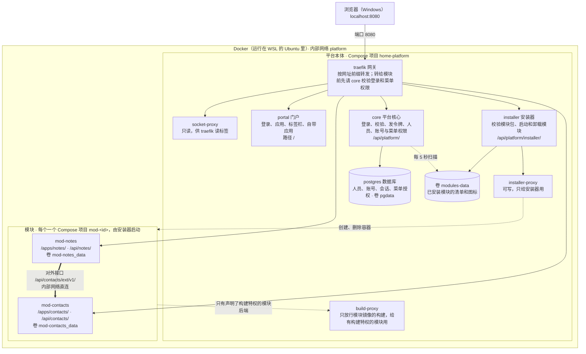

# Vibebooth 架构说明

> 对应代码版本：平台本体（含模块安装器、用户与菜单权限）。模块在各自的仓库里，不属于本仓库；下文用两个假想的模块 `notes`（记事）和 `contacts`（通讯录）举例。代码里的服务、路由、登录流程有变化时，要同步更新本文档。部署步骤见 [DEPLOY.md](DEPLOY.md)，模块开发规范见 [docs/module-spec.md](docs/module-spec.md)。

## 一句话总结

整个平台由 8 个常驻的小程序（平台本体）加上若干个模块组成，每个程序都跑在自己的 Docker 容器里。浏览器只和其中的网关 Traefik 打交道，由网关按网址把请求转给后面对应的程序。模块由安装器单独安装和卸载，平台本体和其他模块不用重启。

从外到里一共四层，每一层都装在上一层里面：

1. **Windows**：你的电脑，浏览器和代理软件运行在这一层。
2. **WSL（Ubuntu）**：Windows 里的一个轻量 Linux 虚拟机。Docker 只能原生运行在 Linux 上，所以需要它。
3. **Docker**：装在 Ubuntu 里的后台服务，负责下载、创建、启动和停止容器。
4. **容器**：平台本体的 8 个程序和每个模块的前端、后端，一个程序一个容器，彼此隔离。

在 Windows 浏览器里打开 `localhost:8080` 能访问到容器，是因为两次转发：WSL 把 Ubuntu 里监听的端口转给 Windows，Docker 再把 Ubuntu 的 8080 端口转给网关容器。

## 整体结构



只有 traefik 对外开放了端口（8080）。其他容器不对外暴露端口，它们在 Docker 的内部网络 `platform` 里用服务名互相访问，模块容器也接在这个网络上。模块后端向 core 获取公钥，用来确认令牌确实是 core 签发的（图里省略了这些线）。粗线表示一个模块的后端直接调用另一个模块的对外接口，不经过网关，见下文“模块之间怎么通信”。

## Docker 的六个概念

用"做菜"打个比方：

| 概念 | 是什么 | 比喻 | 在本项目里 |
| --- | --- | --- | --- |
| 镜像（image） | 打包好的程序加上它运行所需的系统文件，只读 | 预制菜料包 | `postgres:17-alpine` 是直接下载的；`core`、`portal` 是用各自的 `Dockerfile` 现场构建的 |
| 容器（container） | 镜像运行起来之后的一个实例 | 拆开料包做出来的菜 | `docker compose ps` 列出平台本体的 8 个，`docker ps` 还能看到 `mod-` 开头的模块容器 |
| Dockerfile | 说明怎样从源码构建镜像的脚本 | 菜谱 | `core/Dockerfile`：先用 Go 编译，再把编译结果放进一个很小的 alpine 系统 |
| Compose | 用一个文件描述多个容器以及它们的关系，一条命令就能全部启动 | 整桌菜的菜单 | 根目录 `docker-compose.yml` 是平台本体；每个模块有自己的 `compose.yaml`，由安装器作为独立项目 `mod-<id>` 启动 |
| 网络（network） | 容器之间的内部局域网，容器之间用服务名互相访问 | 厨房里的传菜口 | 在 `platform` 网络里，`core` 用 `postgres:5432` 就能连上数据库，`notes-backend` 用 `contacts-backend:8000` 就能连上另一个模块 |
| 卷（volume） | 容器之外保存数据的地方，容器删掉后数据还在 | 冰箱 | `pgdata` 存数据库数据，`core-data` 存登录令牌的签名密钥（`jwt.pem`），`modules-data` 存已安装模块的清单；模块的卷带项目前缀，例如 `mod-notes_data` 存 notes 模块的 SQLite 数据库文件 |

所以 `docker compose down` 只是把"菜"倒掉，"冰箱"里的数据还在；加上 `-v` 才会连冰箱一起清空。卸载模块也一样，默认保留它的卷，勾选“同时删除数据”才会删。

## 各个服务负责什么

前 8 个是平台本体，定义在 `docker-compose.yml` 里；后面是模块，每个模块在自己的仓库里开发，容器定义在模块仓库的 `compose.yaml` 里，打成模块包后由安装器安装。

| 服务 | 是什么 | 职责 |
| --- | --- | --- |
| `traefik` | 网关（现成软件） | 唯一对外的入口（8080 端口），按网址前缀把请求转给对应服务；转给模块之前，先问 `core` 这个人登录了没有、有没有这个页面的菜单权限 |
| `socket-proxy` | Docker 接口的门卫（现成软件） | Traefik 通过读取容器列表来发现路由规则；socket-proxy 只开放"读容器列表"这一项权限，不把整个 Docker 的控制权交出去 |
| `postgres` | 数据库（现成软件） | 存放人员、账号、密码哈希、登录会话和按人的菜单授权 |
| `core` | 平台核心（自己写的 Go 代码） | 处理登录和登出；替网关校验登录状态和菜单权限；给模块签发 5 分钟有效的令牌；管理人员和账号，并通过对外接口把人员名单提供给模块；每 5 秒扫描一次 `modules-data` 卷里的模块清单，生成应用列表 |
| `portal` | 门户（自己写的 React 代码，由 nginx 提供） | 登录页、应用列表和标签栏，以及平台自带的应用：“设置”所有人可见，“用户”和“设置”里的“应用管理”只对管理员显示 |
| `installer` | 模块安装器（自己写的 Go 代码） | 校验上传的模块包，导入镜像，以独立的 Compose 项目启动模块，并把清单写进 `modules-data` 卷；也负责卸载。只有有“应用管理”权限的人能调用（管理员总有） |
| `installer-proxy` | 安装器专用的 Docker 门卫（现成软件） | 开放创建、删除容器、镜像、网络、卷的权限，只接在安装器所在的内部网络上 |
| `build-proxy` | 构建代理（自己写的 Go 代码） | 给声明了 `docker-build` 特权的模块（例如构建器）用的 Docker 门卫：逐个检查请求，只放行构建 `vb-` 开头的模块镜像，以及查看、打标签、导出、删除这些镜像和清理构建缓存；碰不到容器和平台自己的镜像。只接在内部网络 `platform-build` 上 |
| `<id>-frontend` / `<id>-backend` | 模块（各自的仓库，技术栈自选） | 模块 `<id>` 的页面 `/apps/<id>/` 和接口 `/api/<id>/`；后端用 `core` 公开的公钥校验令牌，从而知道是谁在访问 |

## 一次完整访问的过程

以"打开网页 → 登录 → 点开 notes 应用"为例。每一步的请求都先到 Traefik，再由它按网址分发：

1. **打开 `localhost:8080`**：网址不以 `/api/` 开头，Traefik 把请求转给 `portal`，浏览器拿到门户页面。页面再请求 `/api/platform/me`，向 `core` 询问当前用户是谁；如果还没登录，就显示登录页。
2. **登录**：页面把用户名和密码发到 `/api/platform/auth/login`。`core` 到 `postgres` 里核对密码，核对通过后在数据库里记一条会话，并给浏览器发一个 Cookie（`hp_session`）。会话 7 天不用就过期，在用会自动续期，但从登录算起最长 30 天。之后浏览器的每次请求都会自动带上这个 Cookie。
3. **显示应用列表**：门户请求 `/api/platform/apps`。`core` 每 5 秒扫描一次已安装模块的清单，这时只挑出这个人至少有一个菜单的模块，在内部网络里直接调用各模块的健康检查接口，然后把应用列表连同各模块是否健康一起返回。
4. **点开 notes（`/apps/notes/`）**：这条路由挂了登录校验。Traefik 先把请求头（包括 Cookie）发给 `core` 的 `/api/platform/auth/verify`，`core` 检查：是否已登录、这个模块是否存在、这个人有没有这个模块的菜单；如果访问的是某个菜单的页面（例如 `/apps/notes/settings/`），还要有那个菜单。
    - 都通过：返回"放行"，并附上一个 5 分钟有效、只能用于 notes 模块的令牌（JWT），令牌里写着这个人在本模块有哪些菜单和功能权限。Traefik 把令牌放进请求头，再转给 `notes-frontend`。
    - 没有登录：跳回登录页。没有菜单：返回"没有权限"。
5. **模块调用自己的后端（`/api/notes/items`）**：请求同样先经过第 4 步的校验，再到达 `notes-backend`。后端用 `core` 公开的公钥（`/api/platform/.well-known/jwks.json`）确认令牌是真的，从令牌里读出用户和菜单，然后返回这个人的记事。

这样设计的好处是登录逻辑只写在 `core` 一处。每个模块都不用自己实现登录，只需要验证令牌。

## `docker compose up -d --build` 做了什么

这条命令只管平台本体，不碰模块：

1. **读取配置**：读取 `docker-compose.yml` 和 `.env`，把 `${POSTGRES_PASSWORD}` 这类变量替换成 `.env` 里的值。
2. **下载现成镜像**：从 Docker Hub 下载 `traefik`、`docker-socket-proxy`、`postgres`。
3. **构建自己的镜像**（`--build` 的作用）：按各自的 Dockerfile 编译 `core`、`portal`、`installer`。Go 和 Node 只在构建时用到，最终镜像里只保留编译结果，所以宿主机上不需要安装 Go 和 Node。
4. **创建网络和卷**：第一次运行时会创建 `platform`、`socket`、`installer-socket` 三个内部网络，以及 `pgdata`、`core-data`、`modules-data` 三个卷。
5. **按顺序启动**：`core` 配置了"等 `postgres` 健康后再启动"，所以数据库先起来。`core` 启动时会建表；如果数据库里还没有任何用户，就按 `.env` 创建管理员账号。
6. **网关自动发现路由**：每个服务都带着 `traefik.*` 标签，例如 core 的标签表示"网址以 /api/platform/ 开头的请求转给我"。Traefik 通过 `socket-proxy` 读到这些标签后，自动生成转发规则，不需要单独写网关的配置文件。模块容器的标签由安装器生成，所以模块一启动，网关就认出它了。

`-d` 表示在后台运行，关掉终端后容器也不会停。每个服务都配置了 `restart: unless-stopped`，所以 Docker 重启后它们会自动起来，除非你手动执行过 `down`。模块容器也一样。

## 安装一个模块的过程

不管是在门户“应用管理”页上传，还是在命令行运行 `npm run install:local` 或 `scripts/module install <模块包.zip>`，最后都由安装器完成，步骤相同：

1. **打开模块包**：zip 里只能有 `module.yaml`、`compose.yaml`、`images.tar` 和图标。安装器校验清单（规范版本 `platform`、id、版本、服务、菜单、依赖），按白名单检查 `compose.yaml`（不允许端口映射、特权、宿主机网络、挂载宿主机目录、自己写标签等），并确认 `images.tar` 里的镜像正好是 `vb-<id>-<服务>:<版本>`，不能借机覆盖别的镜像。`requires` 里的模块必须已经装好，写了版本（如 `contacts>=0.2`）时版本也要满足；`optional` 里的模块可以没装，装了就要满足版本；反过来，已经被依赖的模块（可选依赖也算）不能装回不满足依赖的旧版本。清单里有 `privileges` 时，要管理员在页面上确认（命令行加 `--allow-privileges`）才继续。
2. **生成最终的 compose 文件**：在模块的 `compose.yaml` 上补上网络 `platform`、Traefik 路由标签（`/apps/<id>/` 和 `/api/<id>/`，排除 `/api/<id>/ext/`）和 `JWKS_URL`。有 `docker-build` 特权的模块，后端再接上网络 `platform-build`，`DOCKER_HOST` 指向构建代理。路由由安装器按约定生成，模块自己写不了，也就抢不走门户或别的模块的网址。
3. **导入镜像并启动**：`docker load`，然后以项目 `mod-<id>` 执行 `docker compose up -d`。网关通过标签自动接上路由，平台本体和其他模块不动。
4. **等健康检查**：最多 60 秒，后端 `/api/<id>/health` 要返回 2xx，前端端口要能连上。
5. **登记**：把清单和图标写进 `modules-data` 卷的 `<id>/` 目录。`core` 下一次扫描（最多 5 秒）就会认出它，门户里出现新卡片。
6. **失败时**：新装的模块删除容器；升级则恢复旧版本。安装日志会显示在页面上或命令行里。

卸载时先从 `modules-data` 卷里移走目录（门户里马上消失），再删除容器和镜像。数据卷默认保留，重新安装同一个模块后数据还在。被别的模块 `requires` 的模块不能先卸载；只被 `optional` 的模块可以卸载，依赖它的模块自己处理它不在的情况。

升级就是安装同一个 id 的新版本包，期间这个模块会中断几秒到十几秒，其他模块不受影响。

安装开始后，关掉页面或断网不会中断安装，结果可以稍后在“应用管理”页查看。

> 已知限制：安装器只检查 `images.tar` 里 `manifest.json` 列出的镜像名。新版 Docker 导入时也可能读取 `index.json` 里的镜像名，理论上一个特意构造的包能借此覆盖别的镜像。因为只有有“应用管理”权限的人能上传，模块包也是自己打的，目前没有处理；以后要安装别人做的模块包时需要补上这项检查。

## 模块之间怎么通信

以 notes 在记事里显示联系人姓名为例（notes 的 `module.yaml` 里写了 `requires: [contacts]`）：

1. 浏览器请求 `/api/notes/items`，和其他模块请求一样先经过网关的登录校验，再到达 `notes-backend`。
2. `notes-backend` 从自己的数据库里读出记事，里面只存了联系人 id；再在内部网络里直接请求 `http://contacts-backend:8000/api/contacts/ext/v1/contacts`，拿到联系人名单。
3. 两边按联系人 id 合并后返回给浏览器。

几条规则：

- **对内接口**（`/api/<id>/...`）只给模块自己的前端用；**对外接口**（`/api/<id>/ext/v1/...`）给其他模块的后端用，契约写在模块仓库的 `contracts/openapi.yaml`，不兼容的改动只能新开 v2。
- 数据只存在拥有它的模块里，其他模块只保存 id，不复制对方的表，避免改名、删除时两边对不上。
- 网关不转发对外接口：每个模块的路由规则都排除了 `/api/<id>/ext/`，浏览器访问会得到 404。
- 被调用的模块不可用时，调用方应该降级显示，而不是整页报错。

**平台的对外接口**：人员（家庭成员等）由平台核心保存，模块通过 `http://core:8080/api/platform/ext/v1/` 只读：读取人员名单、查某个账号属于哪个人，契约见 [contracts/openapi.yaml](contracts/openapi.yaml)。规则和模块的对外接口一样：网关不转发 `/api/platform/ext/`，模块只保存人员 id。人员资料（包括头像）只有管理员在“用户”里改，或者本人在门户右上角换自己的头像，模块不能改。每个人在“用户”里给别人写的备注只对自己生效，模块用对外接口的 `viewer` 参数和 `displayName` 字段把备注当称呼显示。

**目前的限制**：设计里模块之间要带“服务令牌”调用，网关拒绝越权调用；这一层还没实现。现在内部网络里的任何容器都能调用对外接口，所以对外接口只返回其他模块确实需要的字段（例如不返回备注）。以后实现服务令牌时，调用方改为经网关、带令牌调用。

## 人员、账号与权限

人员是家庭成员等“人”，账号是登录用的用户名和密码，都由 `core` 管。一个账号最多属于一个人员（表 `users` 的 `person_id`），一个人员可以有多个账号，也可以没有账号（例如还不用登录的孩子）。删除人员时他的账号保留，只解除关联。关联了人员的账号，显示名称就是人员姓名：管理员或本人改姓名、账号关联到人员时一起改，解除关联后保留原来的名字。管理员在门户的“用户”应用里维护人员，给人员开通账号或关联已有账号，并重置密码、停用账号。“用户”是门户自带的应用，出现在应用页、在标签页里打开，和模块的交互一样，代码在门户里。模块里的业务数据（例如通讯录里的联系人）归模块自己。

权限分两种，都由模块在 `module.yaml` 里声明，平台按人分配，模块自己校验。平台只存“谁有哪个 id”，不理解它代表什么；不需要分权的模块什么都不写。

- **菜单**：模块的页面，网关按网址拦截。不写 `menus` 时平台补一个所有人可见的首页菜单。
- **功能权限**：模块里“能做什么”，例如记分、清零。不对应网址，网关不拦，由模块后端检查，前端据此决定按钮显不显示。“只读”不需要单独的权限：能打开页面、但没有操作权限的人就是只读。

```yaml
menus:
  - {id: home, name: 记事, path: /apps/notes/, default: [user]}
  - {id: settings, name: 设置, path: /apps/notes/settings/, requires: settings}
permissions:
  - {id: edit, name: 编辑, description: 新建和修改记事, default: [user]}
  - {id: settings, name: 设置, description: 清空全部记事, default: [admin]}
```

菜单写了 `requires` 时，这个页面跟着那项功能权限开关，“用户”应用里不再单独列出这个菜单。

- **能不能用整个应用**：管理员在“用户”应用的“权限”页签里给每个账号按应用开关（表 `app_grants`）。关掉的应用对他隐藏，网关也不放行，菜单和功能权限都不生效；没单独设置时，平台默认能用，模块按菜单默认值至少有一个菜单就能用。平台也算一个应用：关掉后他打不开门户（门户只显示“没有权限”，门户接口拒绝他），只能直接打开自己能用的应用，例如 `/apps/family-score/`。
- **谁有哪项权限**：管理员在“用户”应用里对每个账号勾选或取消，覆盖默认值；没改过的跟随默认值。只记录和默认不同的部分（菜单在表 `menu_grants`，功能权限在表 `perm_grants`），模块升级新增的菜单和权限自动按默认值生效。管理员拥有全部权限。
- **平台自己的权限**：平台也按同样的格式声明权限，模块 id 用保留名 `platform`，在“用户”应用里排在第一组。目前有“设置”（打开“设置”应用，默认所有账号）和“应用管理”（安装、升级、卸载应用，默认管理员）。安装器的接口和“重新扫描模块”都按“应用管理”权限放行。“应用管理”权限也很大：有它的人能安装带特权的模块，只给信任的人。“用户”应用不开放：能管账号的人可以给自己勾上任何权限，等于管理员，所以仍然只给管理员。
- **看得到**：一个人对某个模块一个菜单都没有，门户里就看不到这个模块，网关也不放行。
- **页面拦截**：网关校验时，`core` 按网址找到路径最长匹配的菜单，没有就返回“没有权限”。模块首页（`path` 等于 `/apps/<id>/` 的菜单）下还放着静态资源，所以只要有这个模块的任一菜单就能打开；需要单独控制的页面要放在子路径下。
- **接口权限**：令牌里带着这个人在本模块的菜单 id（`menus`）和功能权限 id（`perms`），模块后端用 SDK 的 `Has("settings")` 判断功能权限，没有声明功能权限的旧模块用 `HasMenu`。例如 notes 的“清空全部记事”只允许有“设置”权限的人调用。接口要不要检查、检查哪一项，由模块自己负责。
- **模块前端的导航**：模块前端可以调用 `GET /api/platform/apps/<id>/menus` 拿到当前用户的菜单来渲染导航，不用写死。
- **生效时间**：页面拦截立刻生效；模块令牌 5 分钟有效，而网关每个请求都会重新签发令牌，所以接口权限也是下一个请求就生效。

## 设置入口

模块的设置放在模块自己里面：模块在自己的页面上放设置入口（例如顶栏右侧的“设置”），只对有设置权限的人显示，设置的内容和数据都由模块自己负责；真正的权限由网关的页面拦截和模块后端的 `Has` / `HasMenu` 检查。门户自带的“设置”应用只放平台的系统级设置，目前只有“应用管理”，按平台的“设置”和“应用管理”权限显示。旧清单里菜单上的 `settings: true` 仍然能装，平台不再使用。
