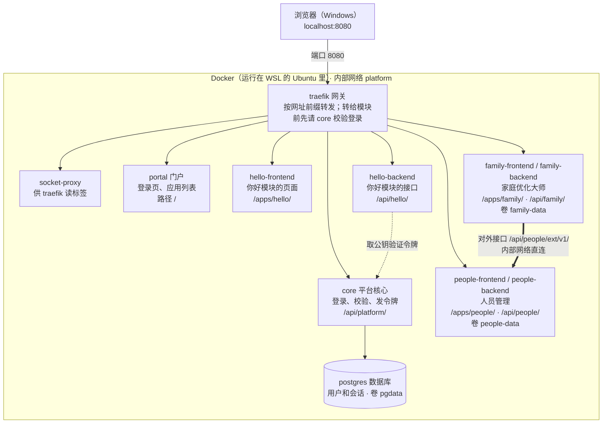

# home-platform 架构说明

> 对应代码版本：第 1 阶段骨架，加上人员管理和家庭优化大师两个模块。代码里的服务、路由、登录流程有变化时，要同步更新本文档。部署步骤见 [DEPLOY.md](DEPLOY.md)。

## 一句话总结

整个平台由 11 个小程序组成，每个都跑在自己的 Docker 容器里。浏览器只和其中的网关 Traefik 打交道，由网关按网址把请求转给后面对应的程序。

从外到里一共四层，每一层都装在上一层里面：

1. **Windows**：你的电脑，浏览器和代理软件运行在这一层。
2. **WSL（Ubuntu）**：Windows 里的一个轻量 Linux 虚拟机。Docker 只能原生运行在 Linux 上，所以需要它。
3. **Docker**：装在 Ubuntu 里的后台服务，负责下载、创建、启动和停止容器。
4. **容器**：平台的 11 个程序，一个程序一个容器，彼此隔离。

在 Windows 浏览器里打开 `localhost:8080` 能访问到容器，是因为两次转发：WSL 把 Ubuntu 里监听的端口转给 Windows，Docker 再把 Ubuntu 的 8080 端口转给网关容器。

## 整体结构

只有 traefik 对外开放了端口（8080）。其他容器不对外暴露端口，它们在 Docker 的内部网络里用服务名互相访问。虚线表示 hello-backend 向 core 获取公钥，用来确认令牌确实是 core 签发的（people、family 的后端也一样，图里省略了）。粗线表示家庭优化大师的后端直接调用人员管理的对外接口，不经过网关，见下文“模块之间怎么通信”。

## Docker 的六个概念

用"做菜"打个比方：

| 概念 | 是什么 | 比喻 | 在本项目里 |
| --- | --- | --- | --- |
| 镜像（image） | 打包好的程序加上它运行所需的系统文件，只读 | 预制菜料包 | `postgres:17-alpine` 是直接下载的；`core`、`portal` 是用各自的 `Dockerfile` 现场构建的 |
| 容器（container） | 镜像运行起来之后的一个实例 | 拆开料包做出来的菜 | `docker compose ps` 列出的那 11 行 |
| Dockerfile | 说明怎样从源码构建镜像的脚本 | 菜谱 | `core/Dockerfile`：先用 Go 编译，再把编译结果放进一个很小的 alpine 系统 |
| Compose | 用一个文件描述多个容器以及它们的关系，一条命令就能全部启动 | 整桌菜的菜单 | `docker-compose.yml`，并通过 `include` 引入 `modules/*/compose.yaml` |
| 网络（network） | 容器之间的内部局域网，容器之间用服务名互相访问 | 厨房里的传菜口 | 在 `platform` 网络里，`core` 用 `postgres:5432` 就能连上数据库 |
| 卷（volume） | 容器之外保存数据的地方，容器删掉后数据还在 | 冰箱 | `pgdata` 存数据库数据，`core-data` 存登录令牌的签名密钥（`jwt.pem`），`people-data`、`family-data` 分别存两个模块自己的 SQLite 数据库文件 |

所以 `docker compose down` 只是把"菜"倒掉，"冰箱"里的数据还在；加上 `-v` 才会连冰箱一起清空。

## 11 个服务各自负责什么

前 5 个是平台本体，定义在 `docker-compose.yml` 里；后面 6 个属于 3 个模块，分别定义在各自的 `modules/<id>/compose.yaml` 里。

| 服务 | 是什么 | 职责 |
| --- | --- | --- |
| `traefik` | 网关（现成软件） | 唯一对外的入口（8080 端口），按网址前缀把请求转给对应服务；转给模块之前，先问 `core` 这个人登录了没有 |
| `socket-proxy` | Docker 接口的门卫（现成软件） | Traefik 通过读取容器列表来发现路由规则；socket-proxy 只开放"读容器列表"这一项权限，不把整个 Docker 的控制权交出去 |
| `postgres` | 数据库（现成软件） | 存放用户、密码哈希和登录会话 |
| `core` | 平台核心（自己写的 Go 代码） | 处理登录和登出；替网关校验登录状态；给模块签发 5 分钟有效的令牌；扫描 `modules/*/module.yaml` 生成应用列表 |
| `portal` | 门户（自己写的 React 代码，由 nginx 提供） | 提供登录页和应用列表页面 |
| `hello-frontend` | 示例模块前端（nginx） | 提供 `/apps/hello/` 下的页面 |
| `hello-backend` | 示例模块后端（Go） | 提供 `/api/hello/` 下的接口；用 `core` 公开的公钥校验令牌，从而知道是谁在访问 |
| `people-frontend` | 人员管理前端（React，nginx 提供） | 提供 `/apps/people/` 下的页面：增删改人员，上传头像 |
| `people-backend` | 人员管理后端（Go + SQLite） | 对内接口 `/api/people/persons` 给自己的前端用；对外接口 `/api/people/ext/v1/persons` 给其他模块用，只返回 id、姓名、照片，写操作只开放修改照片 |
| `family-frontend` | 家庭优化大师前端（React，nginx 提供） | 提供 `/apps/family/` 的记分板和 `/apps/family/settings/` 的设置页 |
| `family-backend` | 家庭优化大师后端（Go + SQLite） | 只存“人员 id → 分数”；人员名单和照片每次向 `people-backend` 的对外接口要，记分板上换的头像也通过对外接口写回人员管理 |

## 一次完整访问的过程

以"打开网页 → 登录 → 点开'你好'应用"为例。每一步的请求都先到 Traefik，再由它按网址分发：

1. **打开 `localhost:8080`**：网址不以 `/api/` 开头，Traefik 把请求转给 `portal`，浏览器拿到门户页面。页面再请求 `/api/platform/me`，向 `core` 询问当前用户是谁；如果还没登录，就显示登录页。
2. **登录**：页面把用户名和密码发到 `/api/platform/auth/login`。`core` 到 `postgres` 里核对密码，核对通过后在数据库里记一条会话，并给浏览器发一个 Cookie（`hp_session`，30 天有效）。之后浏览器的每次请求都会自动带上这个 Cookie。
3. **显示应用列表**：门户请求 `/api/platform/apps`。`core` 在启动时已经扫描过 `modules/*/module.yaml`，这时还会在内部网络里直接调用各模块的健康检查接口，然后把应用列表连同各模块是否健康一起返回。
4. **点开"你好"（`/apps/hello/`）**：这条路由挂了登录校验。Traefik 先把请求头（包括 Cookie）发给 `core` 的 `/api/platform/auth/verify`，`core` 检查三件事：是否已登录、这个模块是否存在、用户的角色是否在模块清单的 `roles` 里。
    - 三项都通过：返回"放行"，并附上一个 5 分钟有效、只能用于 hello 模块的令牌（JWT）。Traefik 把令牌放进请求头，再转给 `hello-frontend`。
    - 没有登录：跳回登录页。角色不符：返回"没有权限"。
5. **模块调用自己的后端（`/api/hello/greeting`）**：请求同样先经过第 4 步的校验，再到达 `hello-backend`。后端用 `core` 公开的公钥（`/api/platform/.well-known/jwks.json`）确认令牌是真的，从令牌里读出用户名，然后回复"你好，admin！"。

这样设计的好处是登录逻辑只写在 `core` 一处。每个模块都不用自己实现登录，只需要验证令牌。

## `docker compose up -d --build` 做了什么

1. **读取配置**：读取 `docker-compose.yml`（包括 include 进来的模块文件）和 `.env`，把 `${POSTGRES_PASSWORD}` 这类变量替换成 `.env` 里的值。
2. **下载现成镜像**：从 Docker Hub 下载 `traefik`、`docker-socket-proxy`、`postgres`。
3. **构建自己的镜像**（`--build` 的作用）：按各自的 Dockerfile 编译 `core`、`portal` 和各模块的前端、后端。Go 和 Node 只在构建时用到，最终镜像里只保留编译结果，所以宿主机上不需要安装 Go 和 Node。
4. **创建网络和卷**：第一次运行时会创建 `platform` 和 `socket` 两个内部网络，以及 `pgdata`、`core-data`、`people-data`、`family-data` 四个卷。
5. **按顺序启动**：`core` 配置了"等 `postgres` 健康后再启动"，所以数据库先起来。`core` 启动时会建表；如果数据库里还没有任何用户，就按 `.env` 创建管理员账号。
6. **网关自动发现路由**：每个服务在 compose 文件里都带着 `traefik.*` 标签，例如 core 的标签表示"网址以 /api/platform/ 开头的请求转给我"。Traefik 通过 `socket-proxy` 读到这些标签后，自动生成转发规则，不需要单独写网关的配置文件。

`-d` 表示在后台运行，关掉终端后容器也不会停。每个服务都配置了 `restart: unless-stopped`，所以 Docker 重启后它们会自动起来，除非你手动执行过 `down`。

## 模块之间怎么通信

以家庭优化大师显示排行榜为例：

1. 浏览器请求 `/api/family/scores`，和其他模块请求一样先经过网关的登录校验，再到达 `family-backend`。
2. `family-backend` 从自己的数据库里读出“人员 id → 分数”，再在内部网络里直接请求 `http://people-backend:8000/api/people/ext/v1/persons`，拿到人员名单和照片。
3. 两边按人员 id 合并后返回给浏览器：人员模块里新加的人从 0 分开始，删掉的人不再显示。

在记分板上点头像换照片时，浏览器把压缩后的照片发给 `/api/family/members/<人员id>/photo`，`family-backend` 再转给 `people-backend` 的 `PUT /api/people/ext/v1/persons/<人员id>/photo`。照片只存在人员管理里，人员管理页面和其他应用看到的都是同一张。

几条规则：

- **对内接口**（`/api/<id>/...`）只给模块自己的前端用；**对外接口**（`/api/<id>/ext/v1/...`）给其他模块的后端用，契约写在 `modules/<id>/contracts/openapi.yaml`，不兼容的改动只能新开 v2。
- 人员信息只存在人员管理模块里，其他模块只保存人员 id，不复制人员表，避免改名、删除时两边对不上。
- 网关不转发对外接口：`people` 的路由规则排除了 `/api/people/ext/`，浏览器访问会得到 404。
- 人员模块不可用时，家庭优化大师降级为只显示分数，打分会提示稍后再试。

**目前的限制**：设计里模块之间要带“服务令牌”调用，网关拒绝越权调用；这一层还没实现。现在内部网络里的任何容器都能调用对外接口，所以对外接口只返回其他模块确实需要的字段（例如不返回备注）。以后实现服务令牌时，调用方改为经网关、带令牌调用。

## 设置入口

门户顶部有“应用”和“设置”两个标签。“设置”页列出声明了设置页的模块，点进去跳到模块自己的设置页，设置的内容和数据都由模块自己负责：

- 模块在 `module.yaml` 里写 `settings: /apps/<id>/settings/`（必须在模块自己的前端路径下），可选 `settingsRoles`（默认 `[admin]`，决定谁能在门户里看到入口）。
- `core` 在 `/api/platform/apps` 的返回里给有权限的用户带上 `settingsUrl`。
- 门户只是不显示入口，真正的权限由模块后端检查。例如家庭优化大师的“分数清零”接口只允许 `admin` 角色调用。
